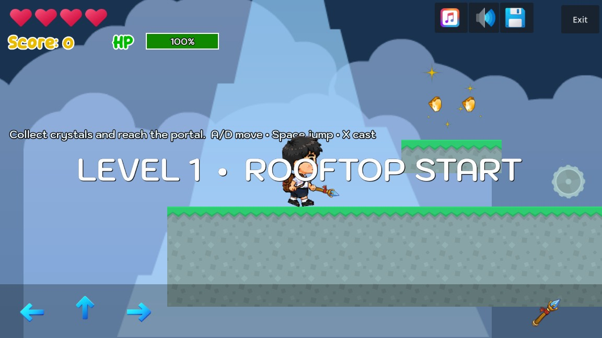
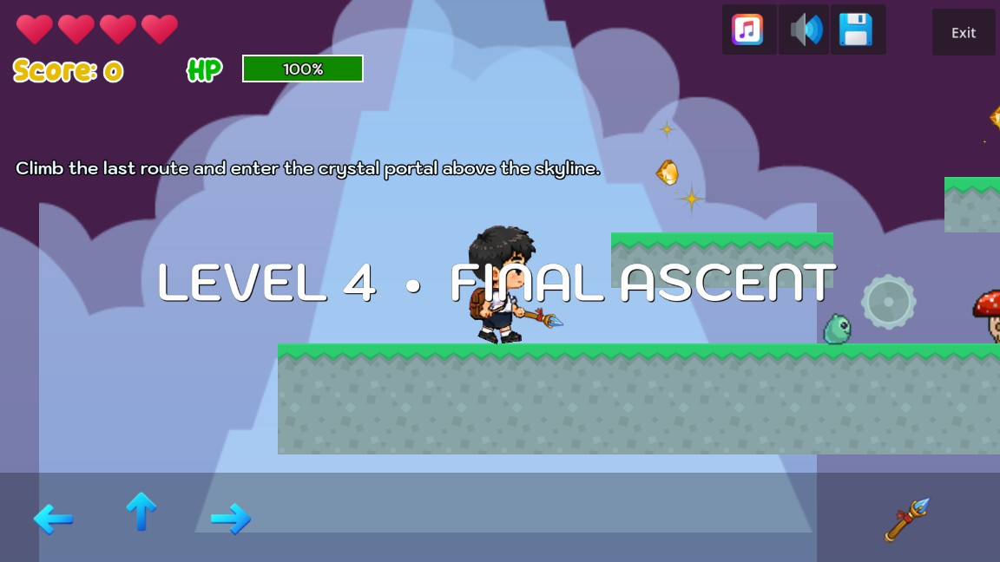

# Crystal Courier: Skyline Run

โครงงานแบบฝึกหัดที่ 4 วิชา Computer Game Development: เกม 2D Platform Side-Scrolling ที่สร้างด้วย Godot 4.7

## ข้อมูลนักศึกษา

- รหัสนักศึกษา: 663380531-2
- ชื่อ-สกุล: ภูริณัฐ ศรีไตรรัตน์

## Game Story

ผลึกพลังงานของเมืองลอยฟ้ากระจัดกระจายไปตาม 4 เขต ผู้เล่นรับบทเป็น Courier รุ่นใหม่ที่ต้องเก็บผลึก ฝ่ากับดัก กำจัดมอนสเตอร์ และเปิดประตูพลังงานเพื่อเชื่อมเส้นทางของเมืองกลับคืนมา

## วิธีเล่น

| ปุ่ม | การทำงาน |
|---|---|
| A / D หรือ ← / → | เดินซ้าย-ขวา |
| Space / W / ↑ | กระโดดและกระโดดสองชั้น |
| X | ยิง Crystal Bolt |
| ปุ่มบนหน้าจอ | รองรับการควบคุมแบบสัมผัส |

เก็บผลึกเพื่อเพิ่มคะแนน เก็บยาเพื่อฟื้น HP หลีกเลี่ยงกับดักและศัตรู แล้วเข้าประตูท้ายด่านเพื่อไปยังด่านถัดไป

## สิ่งที่ทำในขั้นตอน 1-9

1. สร้างโปรเจกต์ `GameLab4` และปรับ README พร้อมเรื่องราวเกม
2. ใช้ตัวละครนักเรียนแบบมี Animation และศัตรู 2 ชนิด: Mushroom กับ Slime
3. ใช้คทาเป็นอาวุธและเปลี่ยนกระสุนเป็น Crystal Bolt
4. ใช้กับดักใบเลื่อยและหอก พร้อมวัตถุประกอบฉาก
5. เพิ่ม Crystal สำหรับคะแนนและ Heal Potion สำหรับฟื้นพลังชีวิต
6. ออกแบบ `level_01` ถึง `level_04` ด้วย TileMapLayer ขนาด 64x64 และ TileSet ที่มี Collision Polygon
7. ใช้ Parallax2D สองชั้น พร้อมฉากภูเขาและเมฆที่ต่างกันในแต่ละด่าน
8. ปรับฉาก Game Over และ Win Game พร้อมภาพ ข้อความ และเสียง
9. เปลี่ยนเพลงเป็น `crystal_route.wav` ที่สร้างใหม่ และเพิ่มเสียงเอฟเฟกต์กระโดด เก็บไอเท็ม บาดเจ็บ เกิดใหม่ และผ่านด่าน

## เปิดโปรเจกต์

1. เปิด Godot 4.7.1 หรือใหม่กว่า
2. Import ไฟล์ `project.godot`
3. กด F5 เพื่อเริ่มจากเมนูหลัก

ตรวจโครงสร้างโปรเจกต์แบบอัตโนมัติได้ด้วย:

```powershell
..\Godot_v4.7.1-stable_win64_console.exe --headless --path . --scene res://scripts/validate_project.tscn
```

## ตัวอย่างหน้าจอ




## ลิงก์โครงการ

- [Play Game](https://avocadough.github.io/GameLab4/)
- [GitHub Project](https://github.com/Avocadough/GameLab4)
- Demo VDO: อัปโหลดไฟล์ `Crystal_Courier_Demo_2min_final.avi` ไปยัง Google Drive หรือ YouTube แล้วเพิ่มลิงก์ที่นี่

## สถานะขั้นตอน 10

- [x] บันทึกวิดีโอสาธิตประมาณ 2 นาที
- [x] บันทึก `docs/demo1.jpg` และ `docs/demo2.jpg`
- [x] Export เกมเป็น Web ที่ `docs/index.html`
- [x] เตรียม Public GitHub Project และ GitHub Pages
- [ ] อัปโหลด Demo VDO ไปยัง Google Drive หรือ YouTube และเพิ่มลิงก์ด้านบน
- [x] กรอกรหัสนักศึกษาและชื่อ-สกุลใน README กับหน้า Credits

## Credits

- Starter project: [computingkku/2D-Platformer-Starter-Kit](https://github.com/computingkku/2D-Platformer-Starter-Kit)
- Original developer: [AdilDevStuff](https://github.com/AdilDevStuff/2D-Platformer-Starter-Kit)
- Educational adaptation: College of Computing, Khon Kaen University
- Starter assets credit: Kenney.nl, craftpix.net, Ravenmore, and Icons8.com
- เพลง `crystal_route.wav`, เสียง `respawn.wav` และภาพ `crystal_bolt.svg` สร้างสำหรับโครงงานนี้
